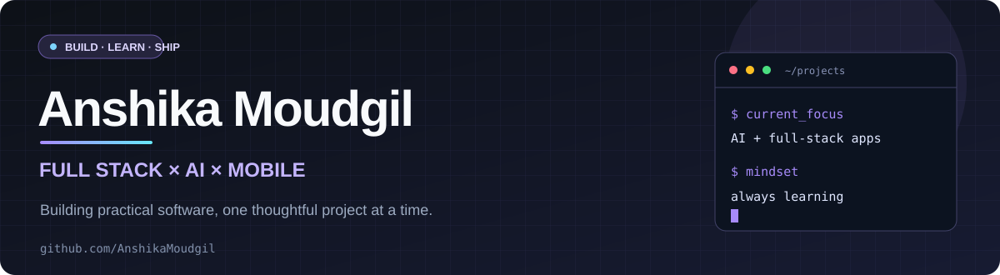
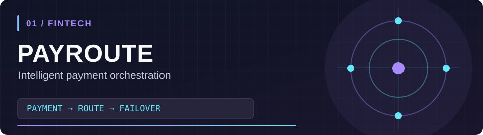
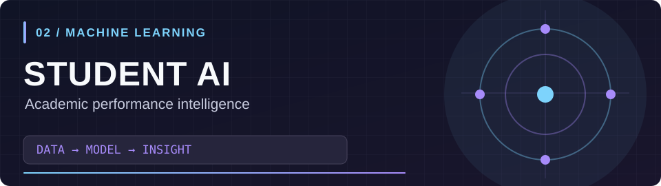
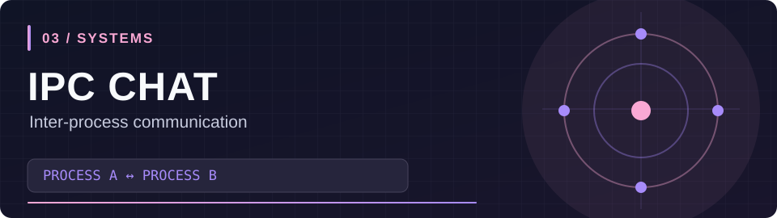
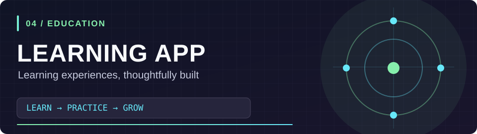
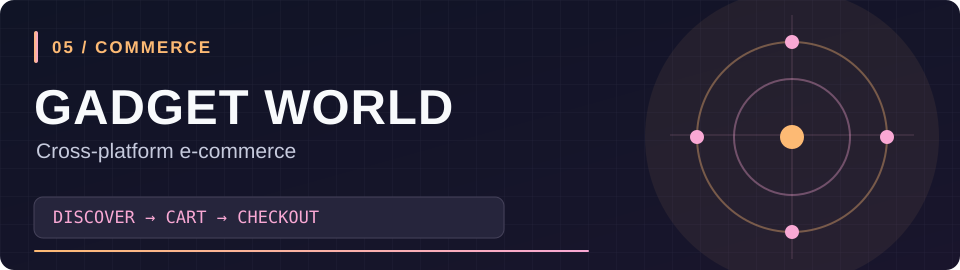
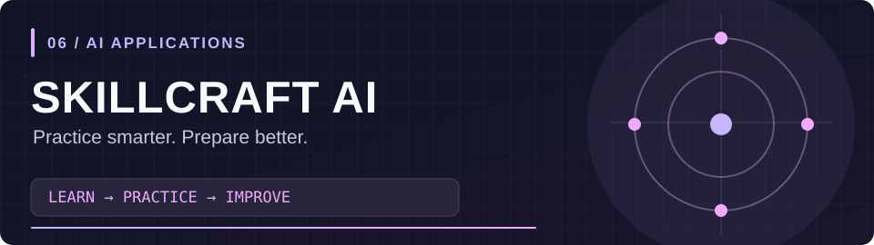

<div align="center">



<br />

### Building ambitious ideas into real software.

**Full-stack engineering** &nbsp;✦&nbsp; **Applied AI** &nbsp;✦&nbsp; **Mobile experiences**

From intelligent applications to fintech infrastructure, I enjoy making products that solve interesting problems — and learning something new with every build.

[**Explore the work ↗**](https://github.com/AnshikaMoudgil?tab=repositories) &nbsp; · &nbsp; [**See contributions ↗**](https://github.com/AnshikaMoudgil?tab=overview)

</div>

---

### 01 / THE PERSON BEHIND THE CODE

<table>
<tr>
<td width="61%" valign="top">

Hey, I'm **Anshika Moudgil**. 👋

I work across **AI, web, backend and mobile engineering** — designing useful experiences on the surface and exploring the architecture that powers them underneath.

I gravitate toward ideas where good engineering meets meaningful outcomes: **payments that recover gracefully, learning tools that adapt, and apps that feel effortless.**

**Currently exploring:** scalable systems, practical machine learning and polished full-stack applications.

</td>
<td width="39%" valign="top">

```yaml
developer: Anshika Moudgil
interests:
  - Product engineering
  - Applied AI
  - Mobile & web
principle: Build • Learn • Refine
```

</td>
</tr>
</table>

### 02 / THE TOOLKIT

<table>
<tr>
<td width="33%" valign="top">

**⌘  LANGUAGES**

`Python` · `Java`

`TypeScript` · `JavaScript`

`Dart`

</td>
<td width="33%" valign="top">

**◈  FRAMEWORKS**

`React` · `Next.js`

`Spring Boot` · `FastAPI`

`Flutter` · `Flask`

</td>
<td width="34%" valign="top">

**◇  INFRA & DATA**

`PostgreSQL` · `Redis`

`Firebase` · `Supabase`

`Kafka` · `Docker`

</td>
</tr>
</table>

<sub>Technologies represented across public projects, rather than a claim of expert-level proficiency in each.</sub>

---

### 03 / SELECTED WORK

<div align="center">

**A collection of things I've been building.**

<sub>Newest repositories first, based on creation order. Each project has its own custom-designed cover.</sub>

</div>

<br />

<table>
<tr>
<td width="50%" valign="top">
<a href="https://github.com/AnshikaMoudgil/PayRoute-Intelligent-Payment-Routing-Failover-Engine"></a>

**[PayRoute](https://github.com/AnshikaMoudgil/PayRoute-Intelligent-Payment-Routing-Failover-Engine)**

A resilient payment-orchestration system exploring intelligent routing, circuit breakers, idempotency and event-driven workflows.

<sub><code>Java</code> <code>Spring Boot</code> <code>PostgreSQL</code> <code>Redis</code> <code>Kafka</code></sub>

[Explore project ↗](https://github.com/AnshikaMoudgil/PayRoute-Intelligent-Payment-Routing-Failover-Engine)
</td>
<td width="50%" valign="top">
<a href="https://github.com/AnshikaMoudgil/student-performance-prediction"></a>

**[Student Performance Prediction](https://github.com/AnshikaMoudgil/student-performance-prediction)**

Deep-learning driven academic performance classification, risk identification and interactive prediction workflows.

<sub><code>Python</code> <code>TensorFlow</code> <code>scikit-learn</code> <code>Streamlit</code></sub>

[Explore project ↗](https://github.com/AnshikaMoudgil/student-performance-prediction)
</td>
</tr>
<tr>
<td width="50%" valign="top">
<a href="https://github.com/AnshikaMoudgil/ipc-groupchat"></a>

**[IPC Group Chat](https://github.com/AnshikaMoudgil/ipc-groupchat)**

A systems-oriented group-chat project exploring inter-process communication.

<sub><code>IPC</code> <code>Systems programming</code></sub>

[Explore project ↗](https://github.com/AnshikaMoudgil/ipc-groupchat)
</td>
<td width="50%" valign="top">
<a href="https://github.com/AnshikaMoudgil/Learning-Management-App"></a>

**[Learning Management App](https://github.com/AnshikaMoudgil/Learning-Management-App)**

An application project centred on digital learning and educational experiences.

<sub><code>Education</code> <code>Application development</code></sub>

[Explore project ↗](https://github.com/AnshikaMoudgil/Learning-Management-App)
</td>
</tr>
<tr>
<td width="50%" valign="top">
<a href="https://github.com/AnshikaMoudgil/gadget-world"></a>

**[Gadget World](https://github.com/AnshikaMoudgil/gadget-world)**

A multi-application gadget marketplace with a Flutter storefront, Dart API and Next.js admin dashboard.

<sub><code>Flutter</code> <code>Dart</code> <code>Next.js</code> <code>Supabase</code></sub>

[Explore project ↗](https://github.com/AnshikaMoudgil/gadget-world)
</td>
<td width="50%" valign="top">
<a href="https://github.com/AnshikaMoudgil/SkillCraft-AI"></a>

**[SkillCraft AI](https://github.com/AnshikaMoudgil/SkillCraft-AI)**

AI-powered career preparation with mock interviews, coding practice, resume workflows and voice features.

<sub><code>React</code> <code>FastAPI</code> <code>Supabase</code> <code>Azure AI</code></sub>

[Explore project ↗](https://github.com/AnshikaMoudgil/SkillCraft-AI)
</td>
</tr>
</table>

<div align="center">

**[Browse the entire collection ↗](https://github.com/AnshikaMoudgil?tab=repositories)**

</div>

---

### 04 / MORE FROM THE WORKBENCH

| Project | What it's about |
| :-- | :-- |
| [**LMS Assessment ↗**](https://github.com/AnshikaMoudgil/lms_Assessment) | Learning assessments |
| [**LMS Flutter Tensorik ↗**](https://github.com/AnshikaMoudgil/lms-flutter-tensorik) | Flutter & Firebase education experience |
| [**LMS Tensorik ↗**](https://github.com/AnshikaMoudgil/lms-tensorik) | Learning-management project |
| [**Humanitarian Risk Intelligence ↗**](https://github.com/AnshikaMoudgil/HumantarianRiskIntelligence) | Risk-intelligence exploration |
| [**SafeHarbor Fintech ↗**](https://github.com/AnshikaMoudgil/SafeHarbor-Fintech) | Financial technology |
| [**Smart File Converter ↗**](https://github.com/AnshikaMoudgil/Smart-file-converter-) | File conversion |
| [**AirWriting ↗**](https://github.com/AnshikaMoudgil/AirWriting) | Air-writing experiment |
| [**Data Analytics ↗**](https://github.com/AnshikaMoudgil/DataAnalytics) | Data analytics |
| [**Credilink ↗**](https://github.com/AnshikaMoudgil/Credilink) | Learning & credentials |

<sub>Additional older projects live on the [Repositories tab](https://github.com/AnshikaMoudgil?tab=repositories). Private repositories aren't disclosed.</sub>

---

<div align="center">

### 05 / KEEP EXPLORING

**Curiosity is the starting point. Building is how ideas become real.**

[**View projects ↗**](https://github.com/AnshikaMoudgil?tab=repositories) &nbsp;&nbsp; · &nbsp;&nbsp; [**Follow on GitHub ↗**](https://github.com/AnshikaMoudgil) &nbsp;&nbsp; · &nbsp;&nbsp; [**Contribution activity ↗**](https://github.com/AnshikaMoudgil?tab=overview)

<br />

*Made with curiosity, code, and lots of iteration. ✦*

</div>